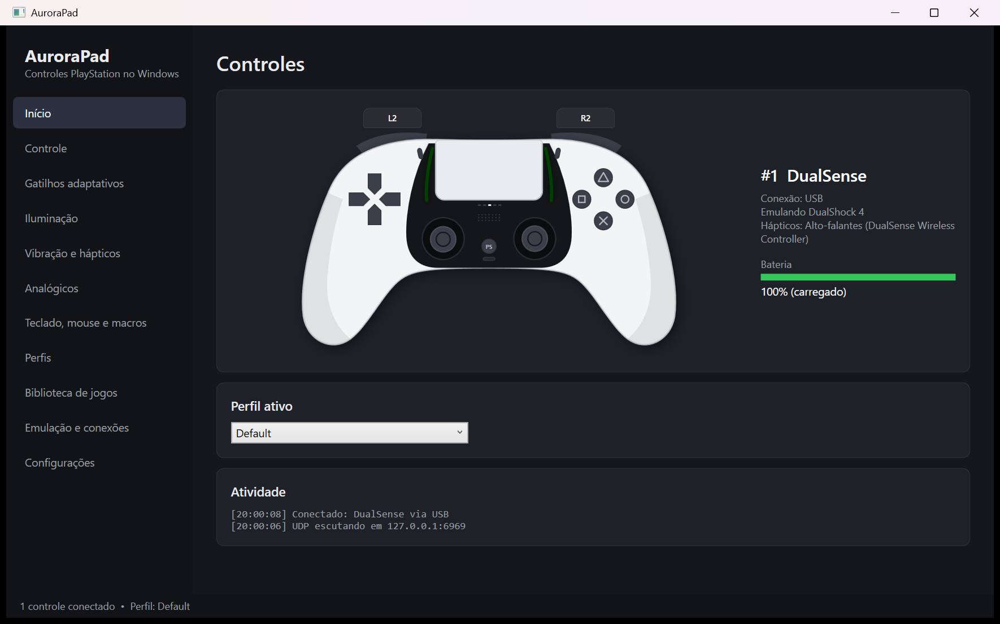
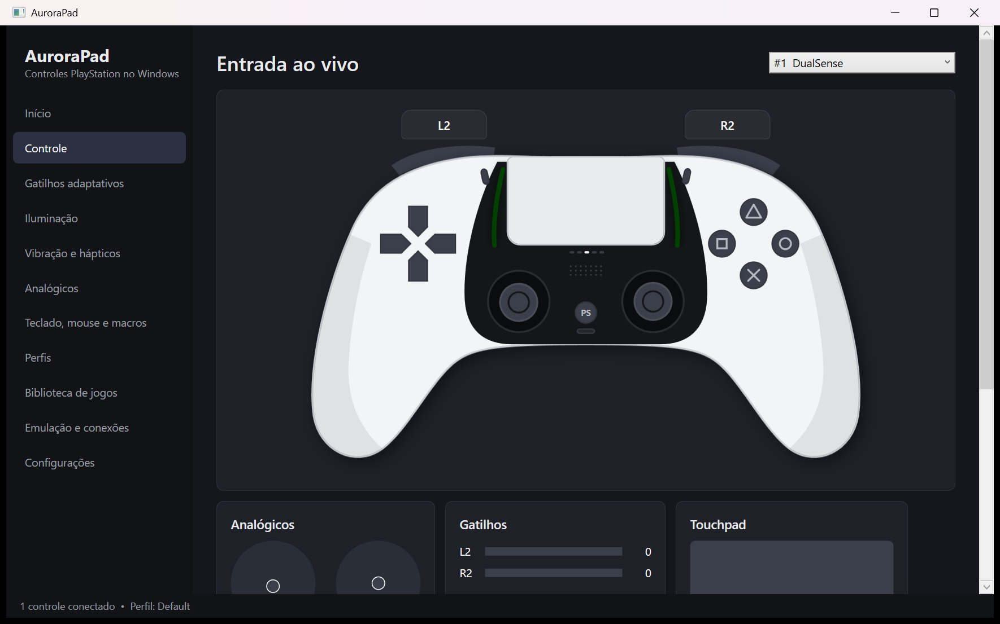
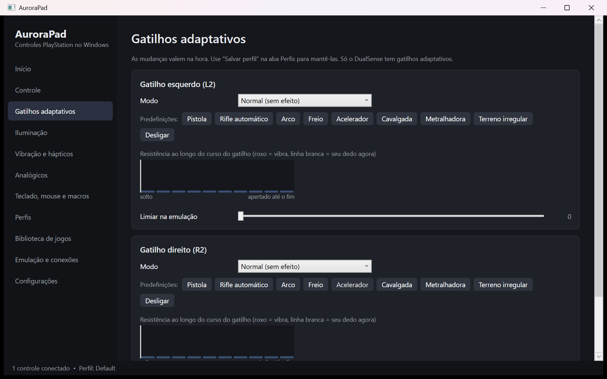
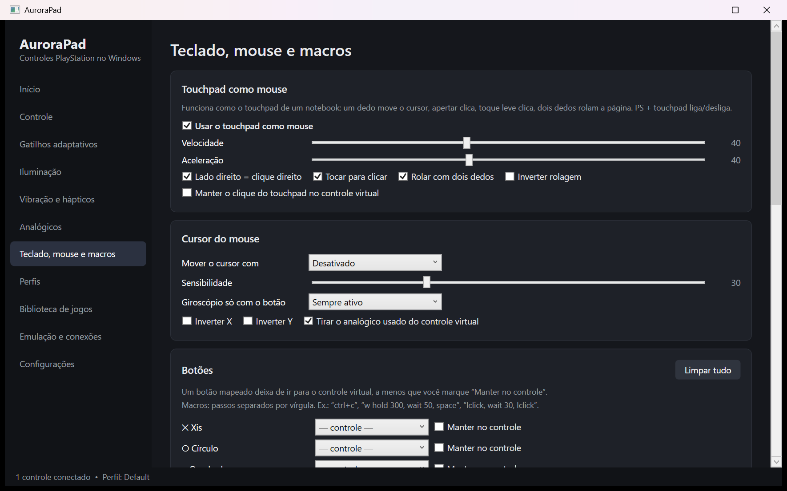
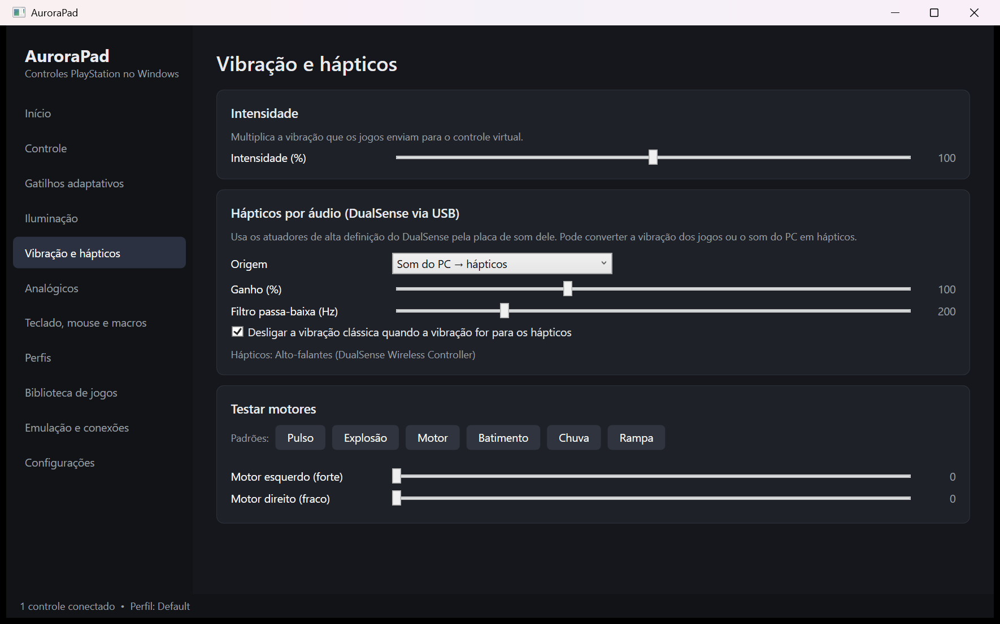
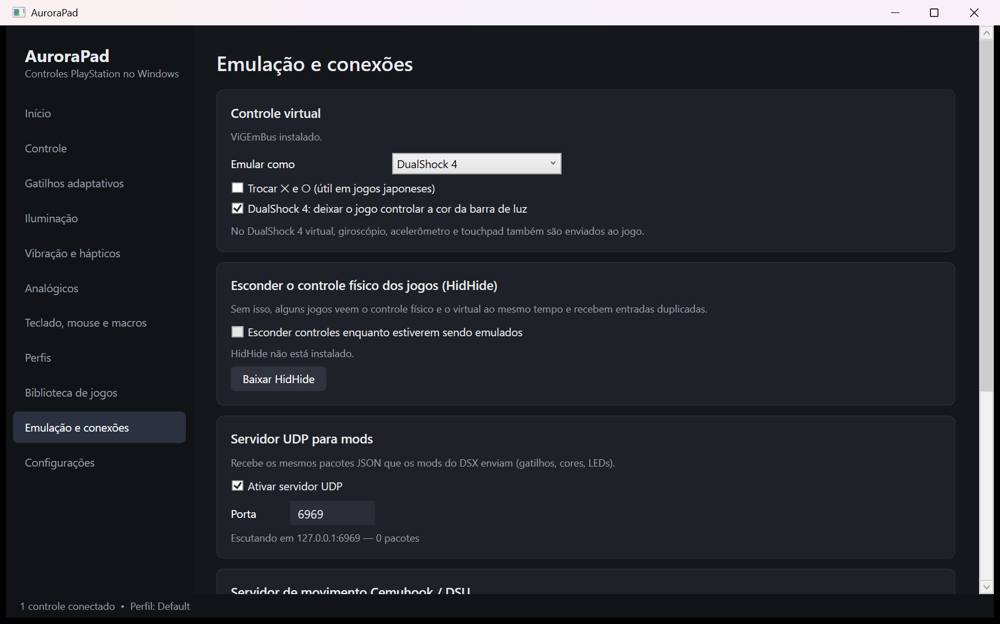

<div align="center">


# 🌌 AuroraPad


**Leve o seu DualSense para o PC de verdade.**
Gatilhos adaptativos, hápticos, barra de luz, touchpad como mouse, emulação de Xbox 360 / DualShock 4 e muito mais — num app leve, bonito e em português.

**Bring your DualSense to the PC for real.**
Adaptive triggers, haptics, lightbar, touchpad as a mouse, Xbox 360 / DualShock 4 emulation and much more — in a light, good-looking app.

### [🇧🇷 Português](#-português) · [🇺🇸 English](#-english)




</div>

---

## 🇧🇷 Português

### ✨ Destaques

| | |
|---|---|
| 🎮 **Controle ao vivo** | Um DualSense desenhado na tela reage a tudo: botões acendem, analógicos se mexem, gatilhos enchem conforme a pressão, o touchpad mostra seus dedos e a barra de luz mostra a cor real. |
| 🔫 **Gatilhos adaptativos** | Resistência, arma semiautomática, rifle, arco, galope, máquina, vibração… com **gráfico da resistência ao longo do curso** e predefinições prontas (pistola, freio, acelerador, cavalgada). |
| 🖱️ **Touchpad como mouse** | Igual ao touchpad de um notebook: um dedo move, apertar clica (lado direito = clique direito), toque leve clica, dois dedos rolam. Só vira mouse depois de **dois toques ou de segurar o dedo** — o controle vibra para confirmar e trava sozinho quando você para de usar. |
| 💥 **Vibração e hápticos HD** | Converte a vibração do jogo — ou o som do PC, ou um **arquivo de áudio** — em hápticos de alta definição pelos atuadores do DualSense — no cabo USB e também sem fio, por Bluetooth. Padrões de teste: pulso, explosão, motor, batimento, chuva. Aviso na bandeja quando a **bateria fica fraca**. |
| 🔊 **Som do PC no controle** | Toca o som do computador no alto-falante do DualSense (ou no fone ligado nele) sem mudar a saída de som do Windows — no cabo USB e também sem fio, por Bluetooth. |
| 🌈 **Iluminação** | Barra de luz RGB com brilho, cor pela bateria, LEDs de jogador e LED do microfone. |
| 🕹️ **Emulação** | Vira um controle **Xbox 360** ou **DualShock 4** (com giroscópio e touchpad) via ViGEmBus. O HidHide esconde o controle físico para evitar entradas duplicadas. |
| ⌨️ **Teclado, mouse e macros** | Qualquer botão vira tecla, clique ou macro (`ctrl+c`, `w hold 300, wait 50, space`). Turbo por botão e cursor pelo giroscópio. |
| 👆 **Ativadores e camadas** | Cada botão pode agir no **toque, toque duplo ou ao segurar** (e o uso normal continua indo para o jogo), modo **alternar** (aperta uma vez, fica segurado) e uma **camada Shift** inteira de mapeamentos enquanto você segura um botão. |
| 🎯 **Mira avançada** | **Flick stick** (o analógico direito vira a câmera na hora), **giroscópio como analógico** para jogos sem suporte a mouse, suavização e **calibração automática** do giroscópio. |
| 🔫 **Gatilhos em dois estágios** | Meio curso e fim de curso viram botões separados: mire no meio, atire no fim. |
| 🎯 **Perfis por jogo** | Biblioteca de jogos da **Steam, Epic e GOG**; o perfil certo entra sozinho quando o jogo abre. |
| 🔌 **Integrações** | Servidor UDP compatível com mods de gatilhos (porta 6969), servidor de movimento **Cemuhook/DSU** para emuladores (Cemu, Dolphin, Ryujinx…) e saída **OSC** (VRChat, TouchDesigner…). |
| ⚡ **Atalhos PS** | PS + Options/Create troca de perfil, PS + touchpad liga/desliga o mouse, PS + △ pausa o controle virtual, PS + ▲/▼ ajusta o brilho. |
| 🪶 **Roda em segundo plano** | Fechar a janela deixa o AuroraPad na bandeja do sistema gastando pouquíssima memória; pode iniciar com o Windows direto na bandeja. |

### 📸 Telas

<table>
<tr>
<td><p align="center"><b>Entrada ao vivo</b></p></td>
<td><p align="center"><b>Gatilhos adaptativos</b></p></td>
</tr>
<tr>
<td><p align="center"><b>Touchpad, mouse e macros</b></p></td>
<td><p align="center"><b>Vibração e hápticos</b></p></td>
</tr>
<tr>
<td colspan="2"><p align="center"><b>Emulação e conexões</b></p></td>
</tr>
</table>

### 🎮 Controles suportados

| Controle | USB | Bluetooth | Gatilhos adaptativos | Hápticos por áudio |
|---|:---:|:---:|:---:|:---:|
| DualSense (PS5) | ✅ | ✅ | ✅ | ✅ (USB e Bluetooth) |
| DualSense Edge | ✅ | ✅ | ✅ | ✅ (USB e Bluetooth) |
| DualShock 4 (PS4) | ✅ | ✅ | — | — |

### 🚀 Começando

### Instalar

1. Baixe **`AuroraPad-<versão>-win-x64.msi`** na pasta [`release-files`](release-files) (ou em **[Releases](../../releases/latest)**).
2. Abra o instalador → **Avançar** → aceite a licença → pronto. Não precisa de administrador nem de .NET: ele instala em `%LOCALAPPDATA%\Programs\AuroraPad` e cria atalhos no Menu Iniciar e na Área de Trabalho.
3. Conecte o controle por cabo ou Bluetooth — ele aparece sozinho.

> Prefere sem instalar? Baixe **`AuroraPad-<versão>-win-x64-portable.zip`**, extraia e rode `AuroraPad.exe`.
>
> O Windows pode mostrar o aviso do SmartScreen porque o instalador não tem assinatura digital paga: clique em **Mais informações → Executar assim mesmo**.

Para desinstalar: **Configurações → Aplicativos → AuroraPad → Desinstalar** (perfis ficam em `%APPDATA%\AuroraPad`).

**Opcionais**
- Emular Xbox 360 / DualShock 4: instale o [ViGEmBus](https://github.com/nefarius/ViGEmBus/releases) (o app tem um botão para isso).
- Esconder o controle físico dos jogos: instale o [HidHide](https://github.com/nefarius/HidHide/releases).

### Compilar e gerar o instalador

Requer o [.NET 9 SDK](https://dotnet.microsoft.com/download). O WiX Toolset vem pelo NuGet, sem instalar nada.

```powershell
.\build-installer.ps1                  # versão do projeto
.\build-installer.ps1 -Version 1.3.0   # ou uma versão específica
```

Os arquivos saem em `artifacts\installer\*.msi` e `artifacts\*-portable.zip`.

### Publicar uma versão no GitHub

O workflow [`.github/workflows/release.yml`](.github/workflows/release.yml) gera o instalador e cria a Release sozinho quando uma tag de versão é enviada:

```bash
git tag v1.2.0
git push origin v1.2.0
```
### 🔌 API UDP para mods

Envie JSON para `127.0.0.1:6969` (formato compatível com mods de gatilhos adaptativos já existentes):

```json
{"instructions":[{"type":1,"parameters":[0,2,13,0,8]}]}
```

| type | instrução | parâmetros |
|---|---|---|
| 1 | TriggerUpdate | controle, gatilho (1=L, 2=R), modo, ...extras |
| 2 | RGBUpdate | controle, R, G, B[, brilho] |
| 3 | PlayerLED | controle, 5 booleanos |
| 4 | TriggerThreshold | controle, gatilho, limiar 0-255 |
| 5 | MicLED | controle, 0=ligado 1=pulsando 2=desligado |
| 6 | PlayerLEDNewRevision | controle, 0-4 = jogador 1-5, 5 = apagado |
| 7 | ResetToUserSettings | controle |

Cada pacote recebe uma resposta JSON com o estado dos controles. Os números dos modos de gatilho estão em [`TriggerSettings.cs`](src/AuroraPad.Core/Triggers/TriggerSettings.cs).

### 📡 OSC

`/dsx/n/lx`, `ly`, `rx`, `ry`, `l2`, `r2` (float) · `/dsx/n/button/<nome>` (0/1, ao mudar) · `/dsx/n/gyro`, `/dsx/n/accel` (3 floats) · `/dsx/n/touch1`, `touch2` (ativo, x, y) · `/dsx/n/battery`

### 🧱 Arquitetura

```
src/
├─ AuroraPad.Core   protocolos HID (DualSense e DS4), gatilhos, hápticos, emulação,
│                   mapeamento/macros, touchpad-mouse, DSU, OSC, UDP, perfis, biblioteca
└─ AuroraPad.App    interface WPF, desenho do controle, traduções (PT/EN/ES)
tools/
└─ AuroraPad.Probe  testes no hardware: dsu, osc, haptics, tree, library, macro, hidhide
installer/          instalador MSI (WiX Toolset) — gerado por build-installer.ps1
assets/             ícone do app
```

Perfis e configurações ficam em `%APPDATA%\AuroraPad`.

### ⚠️ Observações

- O mapeamento para teclado/mouse usa `SendInput`; alguns jogos com anticheat ignoram entrada sintética.
- Por Bluetooth, os hápticos usam o relatório HID 0x32 e o som do PC no alto-falante do controle usa o relatório 0x36 (áudio Opus), sem precisar de cabo.
- O HidHide pode exigir rodar o AuroraPad como administrador.

### 📜 Aviso legal

AuroraPad é um projeto independente e **não é afiliado, endossado ou patrocinado pela Sony Interactive Entertainment**. "PlayStation", "DualSense" e "DualShock" são marcas registradas de seus respectivos donos e são citadas apenas para indicar compatibilidade. A ilustração do controle é original.

Construído com [HidSharp](https://www.zer7.com/software/hidsharp), [ViGEm.Client](https://github.com/nefarius/ViGEm.NET), [Nefarius.Drivers.HidHide](https://github.com/nefarius/Nefarius.Drivers.HidHide), [NAudio](https://github.com/naudio/NAudio), [Concentus](https://github.com/lostromb/concentus) e [CommunityToolkit.Mvvm](https://github.com/CommunityToolkit/dotnet).

Licenciado sob a [MIT License](LICENSE).

<p align="right"><a href="#-english">🇺🇸 English ↓</a></p>

---

## 🇺🇸 English

### ✨ Highlights

| | |
|---|---|
| 🎮 **Live controller** | A DualSense drawn on screen reacts to everything: buttons light up, sticks move, triggers fill with pressure, the touchpad shows your fingers and the lightbar shows its real colour. |
| 🔫 **Adaptive triggers** | Resistance, semi-automatic gun, rifle, bow, galloping, machine, vibration… with a **resistance-over-travel graph** and ready-made presets (pistol, brake, throttle, horse riding). |
| 🖱️ **Touchpad as a mouse** | Works like a laptop touchpad: one finger moves, pressing clicks (right side = right click), a light tap clicks, two fingers scroll. It only becomes a mouse after a **double tap or holding a finger** — the controller vibrates to confirm and locks itself again when you stop using it. |
| 💥 **Rumble and HD haptics** | Turns game rumble — or PC audio, or an **audio file** — into high-definition haptics on the DualSense actuators, over USB and also wirelessly over Bluetooth, with a live level meter. Test patterns: pulse, explosion, engine, heartbeat, rain. Tray warning when the **battery runs low**. |
| 🔊 **PC audio on the controller** | Plays the computer's sound on the DualSense speaker (or a headset plugged into it) without changing Windows' sound output — over the USB cable and also wirelessly over Bluetooth. |
| 🌈 **Lighting** | RGB lightbar with brightness, battery-based colour, player LEDs and the mic LED. |
| 🕹️ **Emulation** | Appears as an **Xbox 360** or **DualShock 4** controller (with gyro and touchpad) through ViGEmBus. HidHide hides the physical controller to avoid double input. |
| ⌨️ **Keyboard, mouse and macros** | Any button can become a key, a click or a macro (`ctrl+c`, `w hold 300, wait 50, space`). Per-button turbo and gyro-driven cursor. |
| 👆 **Activators and layers** | Each button can act on **tap, double tap or hold** (normal use still goes to the game), **toggle** mode (press once, stays held) and a full **Shift layer** of mappings while you hold a button. |
| 🎯 **Advanced aiming** | **Flick stick** (the right stick turns the camera instantly), **gyro as a stick** for games without mouse support, player-space gyro, acceleration, smoothing and **automatic gyro calibration**. |
| 🔫 **Two-stage triggers** | Half pull and full pull become separate buttons: aim at half, fire at full. |
| 🎯 **Per-game profiles** | Game library from **Steam, Epic and GOG**; the right profile loads by itself when the game starts. |
| 🔌 **Integrations** | UDP server compatible with adaptive-trigger mods (port 6969), **Cemuhook/DSU** motion server for emulators (Cemu, Dolphin, Ryujinx…) and **OSC** output (VRChat, TouchDesigner…). |
| ⚡ **PS shortcuts** | PS + Options/Create switches profile, PS + touchpad toggles the mouse, PS + △ pauses the virtual controller, PS + ▲/▼ changes brightness. |
| 🪶 **Runs in the background** | Closing the window keeps AuroraPad in the system tray using very little memory; it can start with Windows straight into the tray. |

### 📸 Screens

<table>
<tr>
<td><p align="center"><b>Live input</b></p></td>
<td><p align="center"><b>Adaptive triggers</b></p></td>
</tr>
<tr>
<td><p align="center"><b>Touchpad, mouse and macros</b></p></td>
<td><p align="center"><b>Rumble and haptics</b></p></td>
</tr>
<tr>
<td colspan="2"><p align="center"><b>Emulation and connections</b></p></td>
</tr>
</table>

### 🎮 Supported controllers

| Controller | USB | Bluetooth | Adaptive triggers | Audio haptics |
|---|:---:|:---:|:---:|:---:|
| DualSense (PS5) | ✅ | ✅ | ✅ | ✅ (USB and Bluetooth) |
| DualSense Edge | ✅ | ✅ | ✅ | ✅ (USB and Bluetooth) |
| DualShock 4 (PS4) | ✅ | ✅ | — | — |

### 🚀 Getting started

### Install

1. Download **`AuroraPad-<version>-win-x64.msi`** from the [`release-files`](release-files) folder (or from **[Releases](../../releases/latest)**).
2. Open the installer → **Next** → accept the license → done. No administrator rights or .NET needed: it installs to `%LOCALAPPDATA%\Programs\AuroraPad` and creates Start menu and desktop shortcuts. You can also choose to start it with Windows in the background.
3. Connect the controller by cable or Bluetooth — it shows up by itself.

> Rather not install? Download **`AuroraPad-<version>-win-x64-portable.zip`**, extract it and run `AuroraPad.exe`.
>
> Windows may show a SmartScreen warning because the installer has no paid code-signing certificate: click **More info → Run anyway**.

To uninstall: **Settings → Apps → AuroraPad → Uninstall** (profiles stay in `%APPDATA%\AuroraPad`).

**Optional**
- Xbox 360 / DualShock 4 emulation: install [ViGEmBus](https://github.com/nefarius/ViGEmBus/releases) (the app has a button for it).
- Hide the physical controller from games: install [HidHide](https://github.com/nefarius/HidHide/releases).

### Build and create the installer

Requires the [.NET 9 SDK](https://dotnet.microsoft.com/download). The WiX Toolset comes from NuGet, nothing else to install.

```powershell
.\build-installer.ps1                  # project version
.\build-installer.ps1 -Version 1.5.0   # or a specific version
```

Output goes to `artifacts\installer\*.msi` and `artifacts\*-portable.zip`.

### Publish a release on GitHub

The [`.github/workflows/release.yml`](.github/workflows/release.yml) workflow builds the installer and creates the Release automatically when a version tag is pushed:

```bash
git tag v1.5.0
git push origin v1.5.0
```

### 🔌 UDP API for mods

Send JSON to `127.0.0.1:6969` (format compatible with existing adaptive-trigger mods):

```json
{"instructions":[{"type":1,"parameters":[0,2,13,0,8]}]}
```

| type | instruction | parameters |
|---|---|---|
| 1 | TriggerUpdate | controller, trigger (1=L, 2=R), mode, ...extras |
| 2 | RGBUpdate | controller, R, G, B[, brightness] |
| 3 | PlayerLED | controller, 5 booleans |
| 4 | TriggerThreshold | controller, trigger, threshold 0-255 |
| 5 | MicLED | controller, 0=on 1=pulsing 2=off |
| 6 | PlayerLEDNewRevision | controller, 0-4 = player 1-5, 5 = off |
| 7 | ResetToUserSettings | controller |

Every packet gets a JSON reply with the controllers' state. Trigger mode numbers are in [`TriggerSettings.cs`](src/AuroraPad.Core/Triggers/TriggerSettings.cs).

### 📡 OSC

`/dsx/n/lx`, `ly`, `rx`, `ry`, `l2`, `r2` (float) · `/dsx/n/button/<name>` (0/1, on change) · `/dsx/n/gyro`, `/dsx/n/accel` (3 floats) · `/dsx/n/touch1`, `touch2` (active, x, y) · `/dsx/n/battery`

### 🧱 Architecture

```
src/
├─ AuroraPad.Core   HID protocols (DualSense and DS4), triggers, haptics, speaker audio,
│                   emulation, mapping/macros, touchpad mouse, DSU, OSC, UDP, profiles, library
└─ AuroraPad.App    WPF UI, controller drawing, translations (PT/EN/ES)
tools/
└─ AuroraPad.Probe  hardware tests: dsu, osc, haptics, bthaptics, btspeaker, tree, library, macro, hidhide
installer/          MSI installer (WiX Toolset) — built by build-installer.ps1
assets/             app icon
release-files/      ready-to-use installer and portable zip
```

Profiles and settings live in `%APPDATA%\AuroraPad`.

### ⚠️ Notes

- Keyboard/mouse mapping uses `SendInput`; some games with anti-cheat ignore synthetic input.
- Over Bluetooth, haptics use HID report 0x32 and PC audio on the controller speaker uses report 0x36 (Opus audio), no cable needed.
- HidHide may require running AuroraPad as administrator.

### 📜 Legal

AuroraPad is an independent project and is **not affiliated with, endorsed or sponsored by Sony Interactive Entertainment**. "PlayStation", "DualSense" and "DualShock" are trademarks of their respective owners and are mentioned only to indicate compatibility. The controller illustration is original.

Built with [HidSharp](https://www.zer7.com/software/hidsharp), [ViGEm.Client](https://github.com/nefarius/ViGEm.NET), [Nefarius.Drivers.HidHide](https://github.com/nefarius/Nefarius.Drivers.HidHide), [NAudio](https://github.com/naudio/NAudio), [Concentus](https://github.com/lostromb/concentus) and [CommunityToolkit.Mvvm](https://github.com/CommunityToolkit/dotnet).

Licensed under the [MIT License](LICENSE).

<p align="right"><a href="#-aurorapad">↑ Top</a></p>
